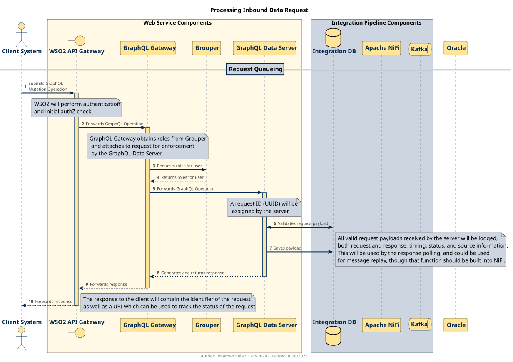
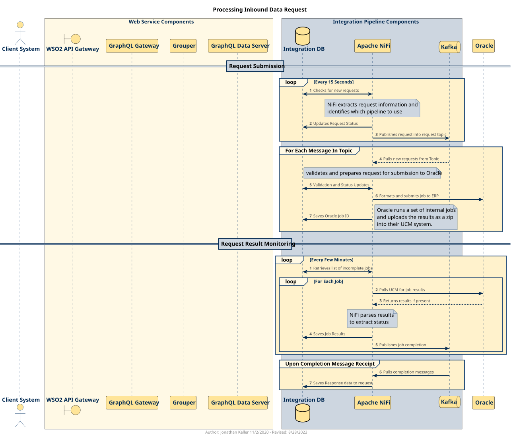
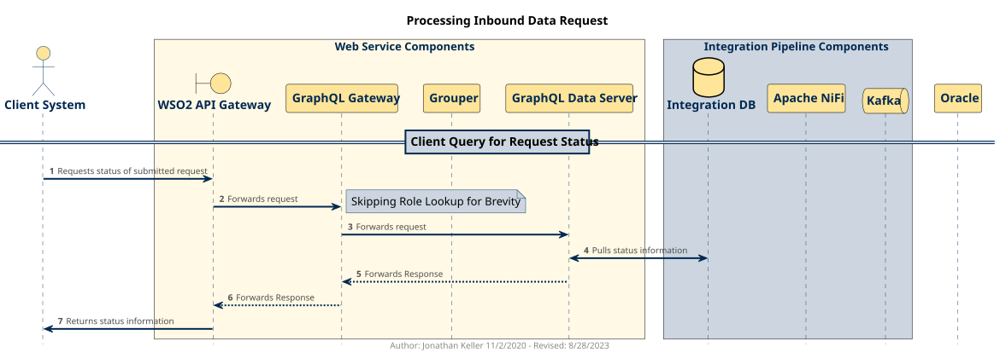

# 3.2.3 Action Requests

<!--BREAK-->
### Action Requests Supported

#### Common Operations

* [Common Types](/3%20GraphQL%20API/3.2%20Oracle%20ERP%20Data%20Server/3.2.3%20Action%20Requests/3.2.3.0%20Common%20Types/HOME)
  * Input and output types common across ERP Action Requests.

#### General Ledger

* [`GlJournal`](/3%20GraphQL%20API/3.2%20Oracle%20ERP%20Data%20Server/3.2.3%20Action%20Requests/3.2.3.1%20GL%20Journal/HOME)
  * Combined GL/PPM Journal import

#### Supply Chain Management / PTP

* [`ScmRequisition`](/3%20GraphQL%20API/3.2%20Oracle%20ERP%20Data%20Server/3.2.3%20Action%20Requests/3.2.3.3%20SCM%20Requisition/HOME)
  * Creation of new purchasing requisitions
* [`ScmInvoicePayment`](/3%20GraphQL%20API/3.2%20Oracle%20ERP%20Data%20Server/3.2.3%20Action%20Requests/3.2.3.2%20SCM%20Payment/HOME)
  * Creation of PO Invoice and Non PO Payment Requests

#### Accounts Receivable

* [`ArInvoice`](/3%20GraphQL%20API/3.2%20Oracle%20ERP%20Data%20Server/3.2.3%20Action%20Requests/3.2.3.4%20AR%20Invoice/HOME)
  * AR Invoices

